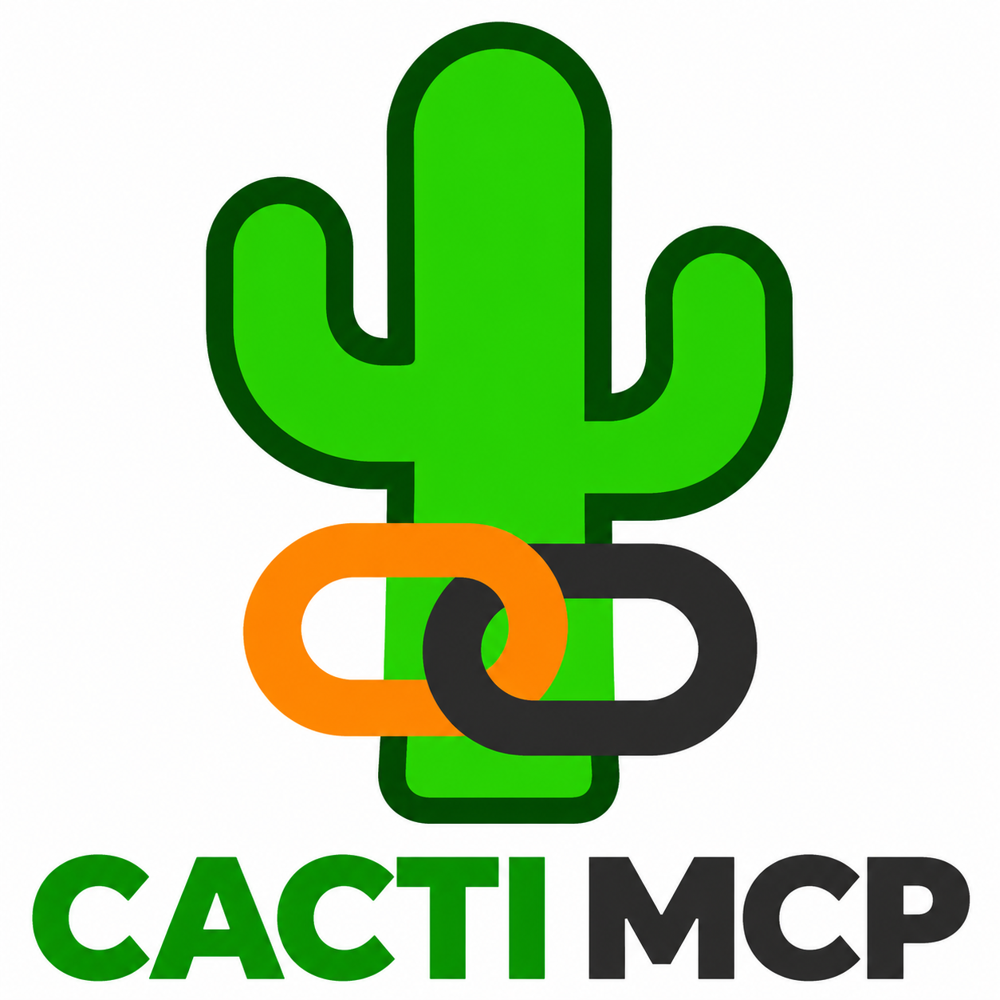

<h1 align="center">
	<picture>
		<source media="(prefers-color-scheme: dark)" srcset="../../../images/cacti_mcp_logo_dark.png">
		
	</picture>
</h1>

<p align="center">
	<a href="https://github.com/somethingwithproof/cacti-mcp/actions/workflows/ci.yml"></a>
	<a href="../../../LICENSE"></a>
	
	
	
</p>

**Languages:** [English](../../../README.md) · [Deutsch](../de/README.md) · [Español](../es/README.md) · [Français](../fr/README.md) · **Italiano** · [Português (BR)](../pt-BR/README.md) · [Nederlands](../nl/README.md) · [Русский](../ru/README.md) · [Українська](../uk/README.md) · [日本語](../ja/README.md) · [한국어](../ko/README.md) · [简体中文](../zh-CN/README.md) · [繁體中文](../zh-TW/README.md) · [العربية](../ar/README.md) · [हिन्दी](../hi/README.md) · [Polski](../pl/README.md) · [Türkçe](../tr/README.md) · [Svenska](../sv/README.md) · [Tiếng Việt](../vi/README.md) · [Bahasa Indonesia](../id/README.md)

<details><summary>More languages (25 African &amp; Asian locales)</summary>

[Afrikaans](../af-ZA/README.md) · [አማርኛ](../am-ET/README.md) · [العربية (مصر)](../ar-EG/README.md) · [العربية (المغرب)](../ar-MA/README.md) · [বাংলা](../bn/README.md) · [فارسی](../fa/README.md) · [Filipino](../fil/README.md) · [Français (Maroc)](../fr-MA/README.md) · [Français (Sénégal)](../fr-SN/README.md) · [Hausa](../ha-NG/README.md) · [עברית](../he/README.md) · [Igbo](../ig-NG/README.md) · [Malagasy](../mg-MG/README.md) · [मराठी](../mr/README.md) · [Bahasa Melayu](../ms/README.md) · [Kinyarwanda](../rw-RW/README.md) · [Soomaali](../so-SO/README.md) · [Kiswahili](../sw-KE/README.md) · [தமிழ்](../ta/README.md) · [తెలుగు](../te/README.md) · [ไทย](../th/README.md) · [اردو](../ur/README.md) · [isiXhosa](../xh-ZA/README.md) · [Yorùbá](../yo-NG/README.md) · [isiZulu](../zu-ZA/README.md)

</details>

Cacti MCP è un adattatore Python che espone le funzionalità del
[plugin Cacti MCP](https://github.com/somethingwithproof/plugin_mcp) come
strumenti MCP su stdio. Il plugin espone già MCP direttamente su HTTP, quindi
usalo quando il tuo client può connettersi a un server remoto. Questo adattatore è
pensato per i client che supportano solo stdio. Utilizza l'SDK Python ufficiale di
MCP e traduce le chiamate agli strumenti nell'API HTTPS del plugin (contratto delle
funzionalità v2, servito sotto i percorsi `/v1/`, solo con token bearer).
Cacti gestisce autenticazione, autorizzazione, validazione ed esecuzione.

**Stato: in sviluppo, pre-1.0.** La versione 0.1.0 supporta l'inventario dei
dispositivi in sola lettura e la lettura delle versioni installate tramite il
[plugin Cacti MCP](https://github.com/somethingwithproof/plugin_mcp) associato.
Non esiste ancora una release taggata. La diagnostica doctor e le riparazioni sono previste per sviluppi futuri.

## Cosa espone

| Operazione | Strumento MCP fornito dal plugin Cacti MCP |
|---|---|
| Elencare i dispositivi visibili al titolare del token | `cacti-list-devices` |
| Leggere i dettagli di un dispositivo consentito | `cacti-get-device` |
| Leggere le versioni di Cacti, del plugin e dell'API | `cacti-get-system-info` |

Nomi, descrizioni e schemi di input provengono dalla risposta di discovery di
Cacti filtrata per permessi. Ulteriori provider in sola lettura consentiti possono
essere scoperti automaticamente senza aggiungere handler di strumenti Python.

```text
MCP client --stdio--> cacti-mcp --HTTPS--> Cacti MCP plugin
                                           |-- Cacti permissions
                                           |-- ability providers
                                           `-- execution audit
```

## Casi d'uso

Collega un client MCP per elencare i dispositivi Cacti visibili al suo utente
dedicato, cercare un dispositivo consentito o recuperare le versioni
dell'installazione quando l'utente dispone del realm amministrativo richiesto. I
nomi e gli schemi di input provengono dalla risposta di discovery del plugin,
quindi l'adattatore non duplica ogni provider. Consulta le
[regole di registrazione delle funzionalità](https://github.com/somethingwithproof/plugin_mcp#write-an-ability-plugin-authors)
del plugin per il modello di registrazione e i limiti attuali.

## Mappa del codice e dei test

| Comportamento | Implementazione | Evidenza di test in questo repository |
|---|---|---|
| Validazione HTTPS, limiti, autenticazione solo bearer e paginazione v2 | [client.py](../../../src/cacti_mcp/client.py) | [test_client.py](../../../tests/test_client.py) |
| Discovery MCP, chiamate e modifiche ai permessi | [server.py](../../../src/cacti_mcp/server.py) | [test_stdio.py](../../../tests/test_stdio.py) |
| Guida da riga di comando, versione e configurazione mancante | [server.py](../../../src/cacti_mcp/server.py), [__main__.py](../../../src/cacti_mcp/__main__.py) | [test_cli.py](../../../tests/test_cli.py) |

Il test con sottoprocesso utilizza un client e un server SDK reali con un
endpoint HTTP fixture. Non richiede né sostituisce una verifica di integrazione
su un'istanza Cacti attiva.

## Garanzie di sicurezza

- Utilizza l'[`mcp` Python SDK ufficiale](https://github.com/modelcontextprotocol/python-sdk)
  per inizializzazione, discovery degli strumenti, chiamate e framing stdio.
- Espone solo funzionalità le cui annotazioni sono esattamente di sola lettura,
  non distruttive e idempotenti. Schemi e nomi provengono da Cacti;
  l'adattatore non contiene SQL, credenziali dei dispositivi o comandi di riparazione.
- Invia esclusivamente il token bearer: nessun cookie, nessun passaggio CSRF. Il
  plugin riverifica la validità del token e i permessi a ogni richiesta.
- Utilizza HTTPS verificato, non memorizza mai cookie, rifiuta i reindirizzamenti
  e ignora le variabili d'ambiente del proxy. HTTP richiede `--allow-loopback-http`
  e un indirizzo loopback letterale oppure `localhost`.
- Limita le chiamate API a 35 secondi complessivi, 5 secondi per la connessione,
  30 secondi di inattività di rete e circa 1 MB per risposta (1.100.000 byte).
  I corpi delle richieste sono limitati a 16.384 byte. Le chiamate sono
  serializzate per sessione client.
- Verifica gli argomenti dello strumento rispetto allo schema di input dell'ultima
  discovery prima di inviarli ed esegue solo gli ID presenti in quel catalogo
  verificato. Una mancata corrispondenza, o uno schema malformato proveniente dal
  server, viene restituita come errore dello strumento, non come crash.
- Non ritenta automaticamente l'esecuzione. Gli errori dello strumento riportano
  solo lo stato HTTP, lo `status` AIP-193 e il `reason` di ErrorInfo; mai il
  testo del messaggio del server, i corpi delle risposte o le credenziali.
  Stdout è riservato ai messaggi MCP.

La versione dell'SDK è fissata da `uv.lock` (`mcp>=2.3,<3` in `pyproject.toml`).
Questo adattatore utilizza il suo server di basso livello 2.x con il trasporto
stdio; non implementa un endpoint MCP HTTP remoto, OAuth, risorse, prompt,
sottoscrizioni o attività in background.

Consulta [il contratto API](../../../docs/api.md) e [il piano di implementazione](../../../docs/plan.md).

## Installazione e riga di comando

Richiede Python 3.12 o successivo e [uv](https://docs.astral.sh/uv/).
Da un checkout di questo repository:

```console
uv sync --locked
uv run --locked cacti-mcp --help
```

Installa e abilita il plugin PHP, assegna il relativo realm a un utente Cacti
dedicato e crea un token di accesso personale per quell'utente (formato `cmcp_pat_`
seguito da 64 cifre esadecimali minuscole) nella console del plugin, nella pagina
My MCP Tokens o tramite il comando `tokens.php`.
I realm Cacti e i permessi sui dispositivi già assegnati all'utente continuano ad applicarsi.

Fornisci il token tramite il tuo secret manager come `CACTI_MCP_TOKEN`; non
aggiungerlo mai al controllo di versione o agli argomenti della riga di comando.
Imposta l'endpoint separatamente. Deve essere un URL HTTPS che termina con
`/plugins/mcp/api.php`, senza credenziali, query o frammenti:

```console
export CACTI_MCP_ENDPOINT=https://cacti.example.com/cacti/plugins/mcp/api.php
uv run --locked cacti-mcp
```

`--endpoint URL` imposta l'endpoint al posto di `CACTI_MCP_ENDPOINT`.
`--allow-loopback-http` consente HTTP in chiaro verso `localhost`, `127.0.0.1` o `::1`
per i test locali, `--lang LOCALE` sovrascrive la localizzazione dei messaggi CLI
e `--version` stampa la versione. Senza sia l'endpoint che `CACTI_MCP_TOKEN`,
il comando termina con un errore di utilizzo.

### Localizzazione

La guida della CLI e i messaggi di errore dell'adattatore sono distribuiti in 45
lingue (`en`, `de`, `es`, `fr`, `it`, `pt-BR`, `nl`, `ru`, `uk`, `ja`, `ko`, `zh-CN`, `zh-TW`, `ar`, `hi`, `pl`, `tr`, `sv`, `vi`, `id`, `af-ZA`, `am-ET`, `ar-EG`, `ar-MA`, `fr-MA`, `fr-SN`, `ha-NG`, `ig-NG`, `mg-MG`, `rw-RW`, `so-SO`, `sw-KE`, `xh-ZA`, `yo-NG`, `zu-ZA`, `bn`, `fa`, `he`, `mr`, `ta`, `te`, `th`, `ur`, `ms`, `fil`) senza alcuna dipendenza aggiuntiva. La risoluzione della lingua controlla `--lang`, poi `LC_ALL`, `LC_MESSAGES` e `LANG`, ripiegando su `en` (anche `C`/`POSIX` e tag sconosciuti risolvono a `en`). I nomi degli strumenti MCP, gli schemi e i payload JSON delle risposte riuscite restano invariati; i messaggi di errore dell'adattatore restituiti con `is_error=True` seguono la lingua attiva.

Il processo attende i messaggi MCP su stdin. Di norma viene avviato da un client MCP.
Per i client che accettano il comune formato di configurazione `mcpServers`:

```json
{
  "mcpServers": {
    "cacti": {
      "command": "uv",
      "args": ["run", "--locked", "--directory", "/absolute/path/cacti-mcp", "cacti-mcp"]
    }
  }
}
```

Configura il client per passare `CACTI_MCP_ENDPOINT` e `CACTI_MCP_TOKEN` al
sottoprocesso tramite il proprio ambiente o meccanismo per i segreti.
L'ereditarietà dell'ambiente dipende dal client. Non esiste un flag da riga di
comando per il token.

La distribuzione Python installabile separatamente fornisce il comando da console
`cacti-mcp`. Non è necessaria alcuna pubblicazione su PyPI per eseguire il
checkout. Il plugin PHP non ha dipendenze Python.

## Rilasci

La versione della distribuzione è registrata in [pyproject.toml](../../../pyproject.toml).
Finché non saranno disponibili release taggate, utilizza un checkout dei sorgenti
oppure l'artefatto `python-distributions` da una
[esecuzione CI riuscita](https://github.com/somethingwithproof/cacti-mcp/actions/workflows/ci.yml).
L'artefatto contiene un wheel e un archivio sorgente. Il pacchetto installato
fornisce sia il comando `cacti-mcp` che `python -m cacti_mcp`; non contiene il
plugin PHP.

## Sviluppo e test

```console
uv sync --locked
uv run --locked ruff check .
uv run --locked ruff format --check .
uv run --locked pytest
uv build
```

I test coprono la validazione HTTP, l'isolamento delle credenziali, le richieste
solo bearer, la paginazione, l'oscuramento degli errori e uno scambio reale in
sottoprocesso tra client e server SDK contro un server HTTP fixture. Non
richiedono un'installazione Cacti attiva.

Il repository utilizza `src/cacti_mcp/`, pytest, Ruff, uv e Hatchling. La CI
esegue i test su Python 3.12, 3.13 e 3.14. Un job di pacchettizzazione separato
compila il wheel e l'archivio sorgente, installa il wheel all'esterno del
checkout ed esegue uno smoke test su entrambi gli entry point. Le distribuzioni e
i risultati dei test sono artefatti del workflow.

## Contribuire

Le pull request vanno indirizzate a `develop`. Mantieni l'adattatore compatibile
con Python 3.12, segui la configurazione di Ruff esistente e la struttura del
pacchetto `src/cacti_mcp/`, e mantieni stdout riservato ai messaggi MCP. Aggiungi
test per ogni modifica al trasporto o al comportamento degli strumenti, esegui le
verifiche indicate sopra e firma i commit con `git commit -s`.
Coordina le modifiche all'API con il plugin Cacti MCP e aggiorna [docs/api.md](../../../docs/api.md).

## Licenza

Copyright (C) 2026 Thomas Vincent. Rilasciato sotto la GNU General Public
License, versione 2 o successiva. Consulta [LICENSE](../../../LICENSE).
